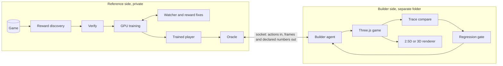

# Architecture

## The idea

To rebuild a game, an agent needs to see every part of it and know what happens after each input. That needs a player who can get everywhere, and a player needs a reward. So the pipeline runs in that order: reward, then player, then rebuild.

## Stages

Stages run in order. A stage passes only with evidence, and only after every earlier stage has passed. State lives in `state.json`, written atomically, so a run survives cancellation, context loss and plugin upgrades.

| Stage | Produces | Passes when |
|---|---|---|
| intake | private copy of the game, chosen mode | mode and rights are valid |
| reward | `games/<slug>.py` | follows the contract |
| verify | contact sheets, timelines | audit, lint, balance and search all pass |
| explore | trained player or search route | reaches levels in test plays |
| oracle | socket server | answers and refuses forbidden requests |
| build | independent Three.js game | isolation check passes |
| compare | per-frame comparison | first divergence is known |
| gate | saved baseline | no regression |

## Components

| Component | File | Job |
|---|---|---|
| Plugin entry | `__init__.py` | Tools, isolation hook, background watcher thread, `/ghostrun` |
| Runner | `core/cli.py` | One command per stage |
| Ledger | `core/ledger.py` | Stage state and rights rules |
| Reward contract | `engine/scripts/reward10/` | Game-agnostic reward. A game only translates RAM into signals |
| Reward checks | `core/reward_lint.py`, `core/balance.py` | Impossible rewards, and whether standing still pays |
| GPU engine | `engine/rl/` | CUDA environment, policy and PPO trainer |
| Watcher | `core/watch.py` | Training health as plain arithmetic |
| Training control | `core/train_ctl.py` | Owned processes, reward versions, the fix loop |
| Oracle | `core/oracle.py` | The only route from builder to game |
| Isolation | `core/isolation.py` | Scans the builder folder |
| Compare, gate | `core/compare.py`, `core/gate.py` | Numeric fidelity and regressions |
| Skills | `skills/` | The judgement parts of each stage |

The split is deliberate. Skills hold judgement, such as how to read RAM. Tools hold anything that must be exact or enforced, such as the gate. The ledger holds anything that must outlive a session.

## Why it works

**One reward, many games.** Progress, level changes, deaths and score behave the same across genres. Only reading them from RAM is game-specific, so a new game is about 100 lines.

**Proof before training.** A wrong reward wastes days of GPU. Each reader must match the screen before any training starts.

**Pixels only for the player.** RAM feeds the reward and never the policy, so the policy can't exploit it and the same policy can later drive something that has no RAM at all, like a rebuild.

**Isolation keeps the rebuild honest.** Give an agent access to the original and it will wrap it instead of rebuilding it. Separate folders, a narrow socket and a default-deny hook make a real rebuild the only way forward.

**Numbers before pictures.** Per-frame traces find the first frame where two games differ. Screenshots mostly find viewer artefacts.

## How isolation is enforced, and its limits

1. Reference and builder folders must not overlap.
2. The oracle accepts a fixed set of operations and rejects unknown ones. It never returns the ROM, its path, RAM or savestates.
3. `pre_tool_call` denies by default: a session reaches the reference only after declaring itself a reference session, and a builder session can't change back.
4. `ghostrun_isolation_check` scans the builder folder for game files, emulator references and symlinks that leave it.

**The hook isn't a security boundary.** It matches paths in tool arguments, so a determined shell command could get around it. For a hard boundary, run the builder under Hermes's Docker terminal backend with only its workspace mounted, or as a separate OS user.

**Declared numbers are a choice.** `observables()` decides which values the builder sees. More numbers make rebuilding faster, and less of a pure black box. Keep it to what you could measure from the screen.

## Durable state

| What | Where |
|---|---|
| Stage ledger | `<reference>/<game>/state.json` |
| Training process, reward version, fix budget | `<reference>/<game>/train.json` |
| Every reward version and why it changed | `<reference>/<game>/reward_versions/` |
| One run folder per reward version | `<reference>/<game>/runs/vNNN/` |
| Watcher history | `<reference>/<game>/evidence/watch/` |
